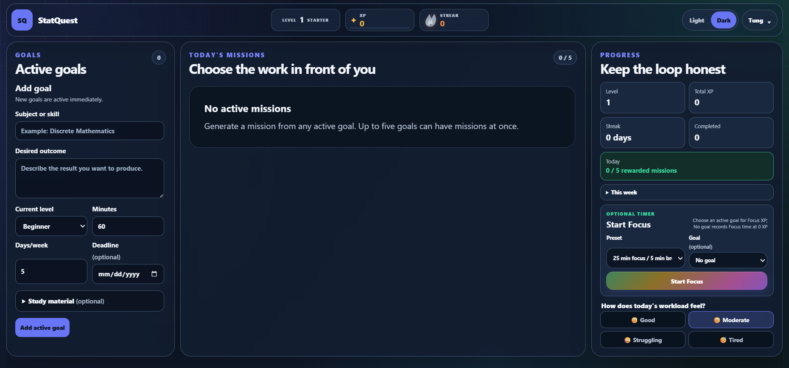
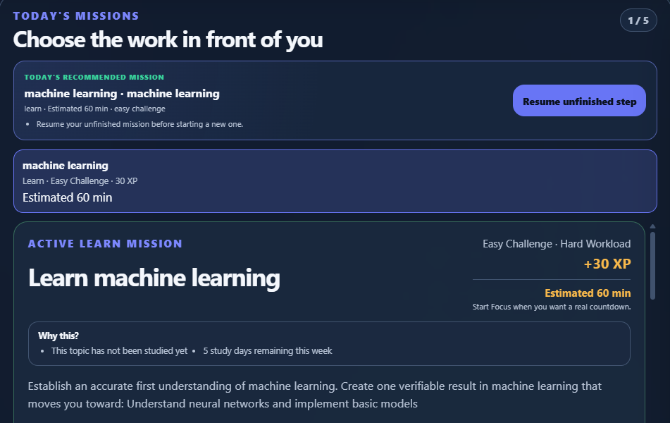
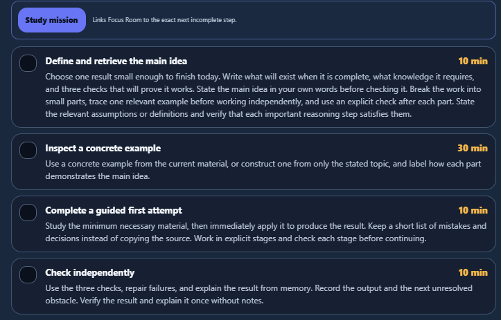
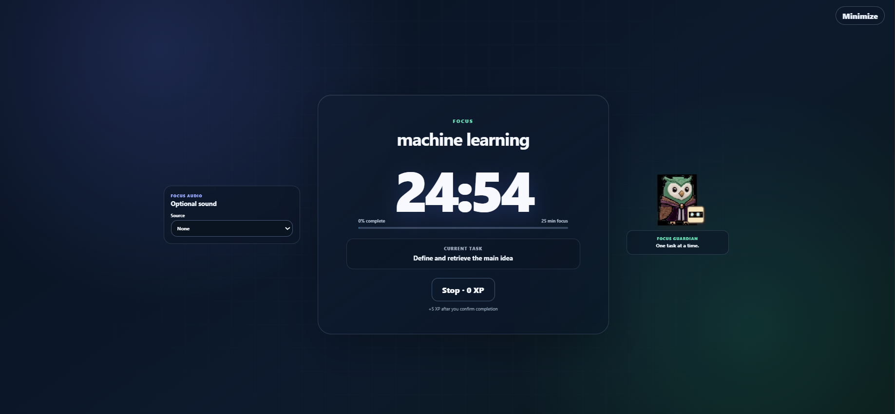

# StatQuest

[](https://github.com/thanhtungnguyen-dev/statquest/actions/workflows/ci.yml)

**StatQuest helps learners turn broad goals into concrete study missions.** Choose what to work on next, complete a focused session, and review your progress.

**[Open StatQuest](https://statquest-azure.vercel.app/)** · [Learning workspace](https://statquest-azure.vercel.app/app)

## What it does

- **Goal planning:** Keep multiple learning goals active and organize what matters next.
- **Daily missions:** Generate actionable study steps based on goals, progress, and learner-confirmed course context.
- **Focus sessions:** Work with a timer, record completed work, and return to unfinished tasks.
- **Progress and review:** Track completed missions, XP, learning history, and scheduled review.
- **Two views, one state:** Focus is a productivity workspace; Adventure presents the same learning data with optional RPG elements.
- **Learning materials:** Use supported PDF, DOCX, TXT, PNG, or JPG content to inform missions after reviewing extracted details.

Recommendations currently use a **deterministic, rule-based learning engine**. StatQuest does not currently offer a generative-AI tutor.

## Product tour

The homepage introduces the product. Select **Start your quest** to open the learning workspace at `/app`. New users can create a browser-local learner profile. Returning users can resume their saved work in the same browser.

| Dashboard | Mission planning |
| --- | --- |
|  |  |

| Mission details | Focus mode |
| --- | --- |
|  |  |

Screenshots illustrate the application and may show an earlier interface.

## Run locally

**Requirements:** Node.js 22+ and npm.

```bash
git clone https://github.com/thanhtungnguyen-dev/statquest.git
cd statquest
npm ci
npm run dev
```

Open [http://localhost:3000](http://localhost:3000) for the landing page or [http://localhost:3000/app](http://localhost:3000/app) for the app.

```bash
npm run typecheck
npm run lint
npm test
npm run build
```

These are also the checks run in [GitHub Actions](https://github.com/thanhtungnguyen-dev/statquest/actions). Passing CI validates automated checks, not every possible browser or usability issue.

## Engineering notes

| Area | Implementation |
| --- | --- |
| UI | Next.js 16, React 19, TypeScript, CSS and CSS Modules |
| Learning logic | Rule-based mission generation, progress, review, focus sessions |
| Persistence | Browser `localStorage` and browser-local profiles |
| Reference processing | PDF.js, Mammoth and Tesseract.js |
| Quality | ESLint, TypeScript, Node.js test runner, GitHub Actions |
| Deployment | Vercel |

The homepage is rendered from `src/app/welcome/` using `src/proxy.ts`; the learning workspace is available at `/app`. The original app implementation remains in `src/app/page.tsx` and shares local state between Focus and Adventure.

Design and implementation context: [PRODUCT.md](PRODUCT.md), [Architecture overview](docs/architecture/overview.md), and [Architecture decisions](docs/architecture/decisions.md).

## Important limitations

- **Local-first MVP:** Profiles are stored in the browser, not backed by secure authentication.
- **No cloud sync:** Data does not automatically follow you to another device, browser, or browser profile. Clearing site data may erase local progress.
- **Uploaded course context:** Extraction may be incomplete. Learners should check and confirm recognized details before relying on a generated mission.
- **Not a verified tutoring service:** Mission guidance supports planning and practice; it is not a guarantee of learning outcomes.

Future work may include account authentication, synchronization, a trusted backend, and additional learning analytics. These are **not current features**.

## Author

Thanh Tung Nguyen · Computer Science student

Developed as an educational and software engineering portfolio project.
